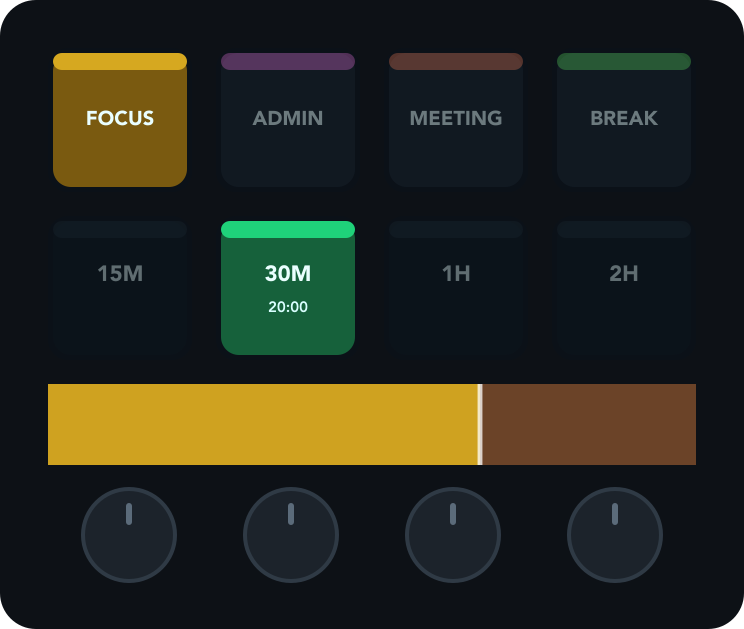
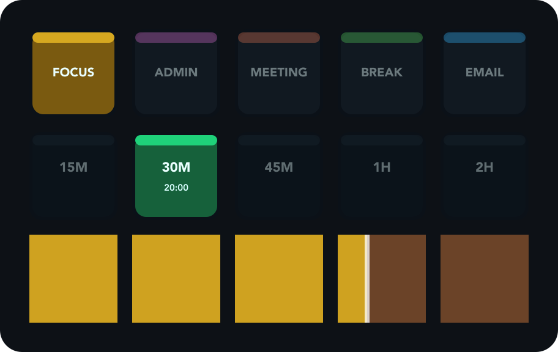

# Stream Deck Timebox

A visual timeboxing timer for Elgato Stream Decks, in the spirit of the
"time timer" clocks many people with ADHD use to stay focused: a block of
colour that shrinks as time passes, with no small numbers to read.

Timebox gives you a row of timers you name yourself and a row of block
lengths you choose. Pick a timer, press a length, and a bar in that timer's
colour shrinks as the block runs.

| Stream Deck + | Stream Deck MK.2 |
|---|---|
|  |  |

*Focus selected and a 30-minute block running, with 20 minutes left
(drawn by the plugin's own rendering code).*

Timebox is a macOS plugin for the Elgato Stream Deck app. It is an
independent project, not made by or affiliated with Elgato or Corsair.

## Supported Stream Decks

| Model | Timers | Blocks | The running block is shown on |
|---|---|---|---|
| Stream Deck + | 4 | 4 | the touch strip, across all four dials |
| Stream Deck MK.2 (15 keys) | 5 | 5 | the bottom row of five keys |

Each model has its own settings, so a Stream Deck + and a Stream Deck MK.2 can
have different timers and blocks. Both need macOS 12 or later and Stream Deck
app 6.6 or later. More models can be added; see `docs/DEVELOPMENT.md`.

## Install

1. Download `StreamDeck-Timebox.streamDeckPlugin` from the latest
   [release](https://github.com/tufacker/streamdeck-timebox/releases).
2. Double-click it. The Stream Deck app installs the plugin and offers the
   **Timebox** profile for your Stream Deck; pick the device when it asks.
3. Switch the Stream Deck to the Timebox profile, then open the settings
   (select any Timebox key in the Stream Deck app) to name your timers.

To update, install the new release the same way; your settings stay in
`timebox.json`.

## Layout

The plugin installs a **Timebox** profile for each model:

| Row | Stream Deck + | Stream Deck MK.2 |
|---|---|---|
| Top | Timers 1–4 | Timers 1–5 |
| Second | Blocks 1–4 | Blocks 1–5 |
| Third | (touch strip and dials) | Timeline keys |

Out of the box the timers are **Focus**, **Admin**, **Meeting**, **Break** and
(on the MK.2) **Email**. The blocks are **15M 30M 1H 2H** on the Stream
Deck + and **15M 30M 45M 1H 2H** on the MK.2. Change them in the settings
(below).

The timeline:

- idle: blank;
- running: the selected timer's colour for the time left, warm brown for the
  time used, and a white line between them;
- paused: the same, with a pause mark;
- finished: all brown, while the block's key pulses green and counts the
  overtime up.

## Using it

- Press a **timer** key to choose what you're timing. It doesn't start
  anything.
- Press a **block** key to start that block for the chosen timer. Its key
  counts the time left.
- Press the **running block's key** again to pause; press it once more to
  resume.
- Adjust the time left by a minute at a time without changing the block:
  - Stream Deck +: turn **dial 1** (clockwise adds time);
  - Stream Deck MK.2: press the **leftmost** timeline key for a minute less,
    the **rightmost** for a minute more.
- Stop and clear the timer:
  - Stream Deck +: press **any dial**;
  - Stream Deck MK.2: press the **middle** timeline key.

While a block runs, the other keys dim so the active one stands out.

## Settings

Select any Timebox key (or dial) in the Stream Deck app to open the settings
for that Stream Deck model:

- **Timers:** a name and two colours for each top-row key: the key colour,
  and the timeline colour used for the time left.
- **Time blocks:** each second-row key's length in minutes (1–480), and an
  optional label of up to six characters. Without a label, a block shows
  `25M`, `1H`, `90M` and so on.

Press **Save** and the deck updates straight away, even mid-block.
**Examples** fills in the model's defaults again.

The settings are kept in `~/Documents/StreamDeck Timebox/timebox.json`, one
section per model, which you can also edit by hand:

```json
{
  "stream-deck-plus": {
    "timers": [
      { "name": "Writing", "color": "#7a5a10", "accent": "#d6a820" },
      { "name": "Email", "color": "#6c315f", "accent": "#d96ccf" },
      { "name": "Calls", "color": "#7a3828", "accent": "#e27653" },
      { "name": "Break", "color": "#2f7534", "accent": "#56d35a" }
    ],
    "blocks": [25, 50, { "minutes": 5, "label": "Rest" }, 90]
  },
  "stream-deck-mk2": {
    "timers": [{ "name": "Deep Work" }, { "name": "Admin" }],
    "blocks": [15, 30, 45, 60, 120]
  }
}
```

Anything missing or invalid falls back to the example for that key, so a
section can list just the timers you want to change. After editing the file
by hand, restart the Stream Deck app to load it. (A file from an older
Timebox, with `timers` and `blocks` at the top level, is read as the Stream
Deck + section.)

## Install from source

You need Node.js 22.18 or later and the Stream Deck app.

```zsh
npm install
npm run verify     # type-check, test, and build
./install.sh       # copy the plugin into the Stream Deck app and restart it
```

`npm run verify` builds:

- `com.tuf.streamdeck-timebox.sdPlugin/bin/plugin.js`, the plugin itself;
- a profile for each model in `com.tuf.streamdeck-timebox.sdPlugin/`,
  installed with the plugin;
- `dist/StreamDeck-Timebox.streamDeckPlugin`, a package you can double-click to
  install, and spare copies of the profiles in `dist/`.

## Development

```zsh
npm run check      # TypeScript
npm test           # timer, drawing, settings and model tests
npm run watch      # rebuild and restart the plugin on every change
```

`docs/DEVELOPMENT.md` covers how the code fits together, how to add a Stream
Deck model, the Stream Deck details that took time to learn, troubleshooting,
and ideas for later. `CHANGELOG.md` lists what changed. `npm run screenshots`
redraws the images above.

## Troubleshooting

If the keys don't respond, check the Stream Deck log:

```zsh
tail -n 200 "$HOME/Library/Logs/ElgatoStreamDeck/StreamDeck.log" | grep -i -E 'com.tuf.streamdeck-timebox|Plugin connected|Problem with connecting|Device connected'
```

If it shows `Read serial number: FAILED` or `Problem with connecting HID
device`, the Stream Deck app has lost the hardware: unplug and reconnect the
Stream Deck, then restart the app.

The plugin's own log (including any problem reading `timebox.json`) is in
`~/Library/Application Support/com.elgato.StreamDeck/Plugins/com.tuf.streamdeck-timebox.sdPlugin/logs/`.

## License

MIT; see [LICENSE](LICENSE). Stream Deck is a trademark of Corsair Memory, Inc.
